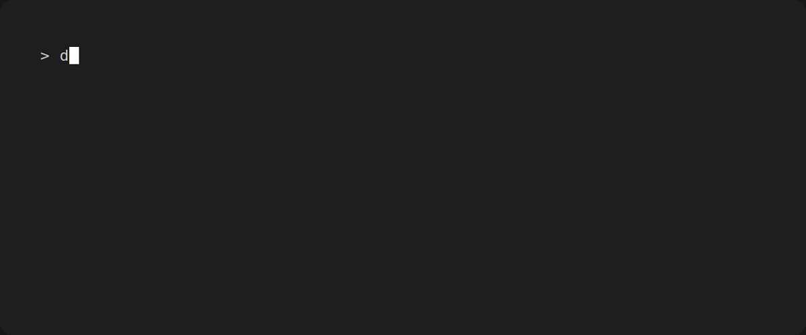
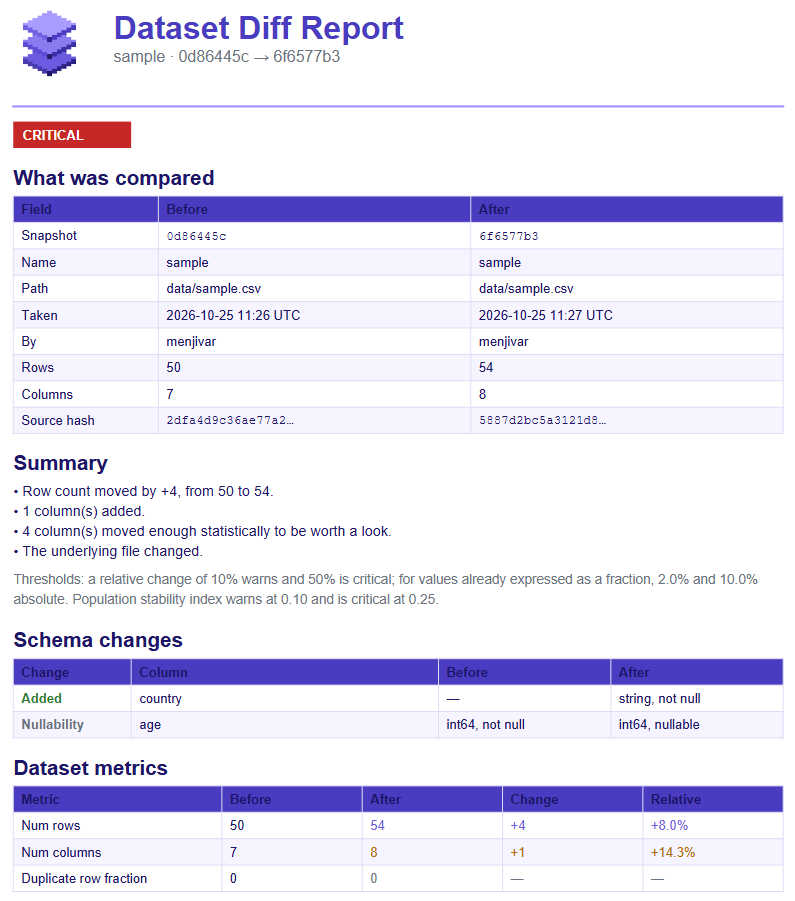

# dstrack

[](https://github.com/leoyala/dstrack/actions/workflows/unittests.yaml)
[](https://codecov.io/github/leoyala/dstrack)

<p align="center">
  
</p>


A Python package for versioning and monitoring dataset changes throughout the machine learning lifecycle.

<p align="center">
  
</p>


<figure markdown="span">

<figcaption>Exemplary PDF report (1st page only)</figcaption>
</figure>

## Overview

`dstrack` helps data scientists and ML engineers track how datasets evolve over time, catching schema drift, distribution shifts, and unexpected mutations before they silently break pipelines or degrade model performance.

## What dstrack is (and isn't)

`dstrack` records *semantics* about a dataset - its schema, a content fingerprint, and per-column statistics - not the dataset itself.
It is not a data version control system: unlike DVC, LakeFS, or Git LFS, it never copies your files into a store or pushes them to a
remote, and it cannot check an old version of `data.csv` back out for you. Your data stays wherever it already lives, and `dstrack` keeps a small,
human-readable audit trail beside your code so you can see how that data changed and when. If you need to store and retrieve the bytes, reach for
DVC and use `dstrack` alongside it.

## Installation

```bash
pip install dstrack
```

Requires Python 3.11 or later.

## Getting started

Initialize a store in your project, then take your first snapshot.

**1. Create a local store** - this adds a `.dstrack/` directory at the current location:

```bash
dstrack init
```

```text
ℹ Generating local store structure at /path/to/.dstrack.
✔ Finished creating local store: /path/to/.dstrack
```

**2. Track a dataset** - point `dstrack` at a data file to snapshot it. Given a small
`data.csv`:

```csv
id,name,value
1,alpha,10.5
2,beta,20.0
3,gamma,15.25
```

```bash
dstrack track data.csv
```

```text
ℹ Reading data.csv and computing snapshot...
✔ Snapshot <snapshot-uuid> written (new dataset, dataset <dataset-uuid>).
ℹ Stored at /path/to/.dstrack/datasets/<dataset-uuid>/snapshots/<snapshot-uuid>.json
```

**3. Re-track as the data changes** - running `track` again on the same path extends the
dataset's lineage instead of starting a new one:

```bash
dstrack track data.csv
```

```text
✔ Snapshot <snapshot-uuid> written (continued lineage, dataset <dataset-uuid>).
```

Each snapshot captures the file's schema, a content fingerprint, and per-column
statistics. See the [Getting Started guide](https://leoyala.github.io/dstrack/getting_started/)
for options such as `--name`, `--reader`, and `--dataset-id`.

**4. See what changed** - `dstrack log` shows *that* a dataset changed;
`dstrack diff` shows *what* changed:

```bash
dstrack diff data.csv
```

The two snapshots are shown side by side, with the schema changes, the dataset's own
numbers, and every column whose statistics moved, each colored by how much it should
worry you. Add `--json` for a pipeline to read, or `--pdf report.pdf` for a formatted
report to share (needs the `report` extra).

It is a library too, so a comparison can be done entirely from Python:

```python
from dstrack.diff import diff_snapshots

result = diff_snapshots(old_payload, new_payload)
print(result.severity, result.summary)
```

## Features

- **Dataset versioning** - snapshot a dataset and track its lineage across pipeline stages
- **Rich snapshots** - schema hash, content fingerprint, and per-column statistics (ranges, null rates, and more)
- **Snapshot comparison** - schema, statistics and distribution-shift diffs, in the terminal, as JSON, or as a PDF report
- **CSV out of the box** - pure standard-library reader, no heavy dependencies
- **Lightweight CLI** - a small, git-like local store you can commit alongside your code

## Roadmap

Drift monitoring in CI is next - comparing a working file against its latest snapshot
and failing the build when data drifts. See the [roadmap](docs/roadmap.md) for what's
planned.
