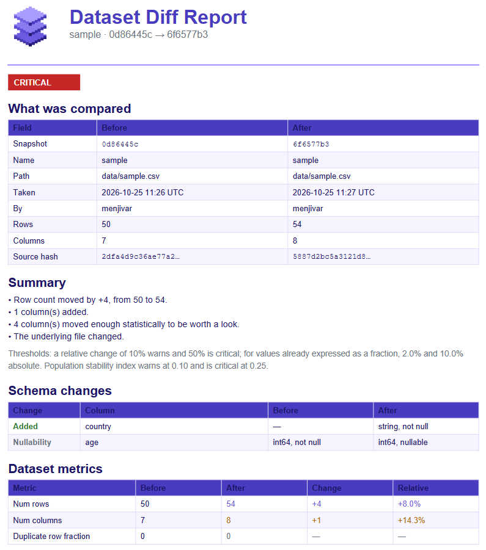

# Getting Started

This guide walks through the full `dstrack` workflow: initializing a store, taking your
first snapshot, and understanding how snapshots and lineage work.

## Prerequisites

- **Python 3.11 or later**
- Install the package:

```bash
pip install dstrack
```

- Verify the installation:

```bash
dstrack version
# 0.1.0
```

## 1. Initialize a store

`dstrack` keeps its history in a local store - a `.dstrack/` directory, conceptually
similar to git's `.git/`. Create one at the root of your project:

```bash
dstrack init
```

```text
ℹ Generating local store structure at /path/to/.dstrack.
✔ Finished creating local store: /path/to/.dstrack
```

This creates:

```text
.dstrack/
├── datasets/     # one directory per tracked dataset
└── .gitignore    # ignores the local .cache/ directory
```

A few things worth knowing:

- The store is discovered by walking **up** the directory tree from where you run a
  command, so you can `track` datasets from any subdirectory of your project.
- Set the `DSTRACK_ROOT_PATH` environment variable to point at a store elsewhere.
- Re-running `init` where a store already exists fails by design. Pass `--allow-exists`
  to turn that into a warning instead:

```bash
dstrack init --allow-exists
```

```text
⚡ Local store path already exists: /path/to/.dstrack
```

## 2. Track a dataset

Tracking reads a data file, computes a **snapshot**, and stores it. Create a small
`data.csv` to follow along:

```csv
id,name,value
1,alpha,10.5
2,beta,20.0
3,gamma,15.25
```

Then snapshot it:

```bash
dstrack track data.csv
```

```text
ℹ Reading data.csv and computing snapshot...
✔ Snapshot <snapshot-uuid> written (new dataset, dataset <dataset-uuid>).
ℹ Stored at /path/to/.dstrack/datasets/<dataset-uuid>/snapshots/<snapshot-uuid>.json
```

A snapshot is an immutable record of the dataset's state at that moment. It captures:

- **Schema** - column names and inferred types, plus an order-independent `schema_hash`
- **Content fingerprint** - a SHA-256 hash of the source file
- **Per-column statistics** - counts, ranges, null rates, and distribution summaries

The dataset name defaults to the file stem (`data` above); override it with `--name`.

## 3. Snapshots and lineage

Run `track` again on the **same path** and `dstrack` recognizes the dataset, extending its
lineage rather than starting a new one. The new snapshot points back to the previous one
via its `parent_snapshot_id`:

```bash
dstrack track data.csv
```

```text
✔ Snapshot <snapshot-uuid> written (continued lineage, dataset <dataset-uuid>).
```

If you rename or move a dataset file, the recorded path no longer matches, so `dstrack`
would start a new lineage. To keep the history connected, continue the existing dataset
explicitly with `--dataset-id`:

```bash
dstrack track renamed.csv --dataset-id <dataset-uuid>
```
For more information on what `dstrack track` allows you to do, simply ask for the help:

```bash
dstrack track --help
```

## 4. View a dataset's history

`dstrack log` shows a dataset's snapshots as a timeline, newest first. Point it at the
dataset's path, and `dstrack` works out which dataset that is:

```bash
dstrack log data.csv
```

```text
● a587afd9  Customers  HEAD
│ 2 minutes ago  by you
│ 4 rows +1   3 cols
│ data.csv
│
● 605eb940  Customers
│ 5 minutes ago  by you
│ 3 rows +1   3 cols
│ data.csv
│
● 0c82297f  Customers
  1 hour ago  by you
  2 rows   3 cols
  data.csv
```

Each node is one snapshot, showing how its row and column counts changed from the
snapshot below it. `HEAD` marks the latest.

This is also how you find the `--dataset-id` the rename above needs: pass the path while
it still matches, or list what the store knows by asking for a dataset that isn't there.
A dataset id works anywhere a path does, and keeps working after the file is renamed,
moved, or deleted:

```bash
dstrack log <dataset-uuid>
```

Useful flags: `-n 5` to show only the latest few, `--oneline` to condense each snapshot
to a single line, and `--reverse` to read oldest-first.

## 5. Compare two snapshots

`dstrack log` says *that* a dataset changed. `dstrack diff` says *what* changed. Point it
at the dataset and it compares the latest snapshot against the one before it:

```bash
dstrack diff data.csv
```

The output puts the two snapshots side by side and colors each difference by how much it
should worry you: the schema changes first, then the dataset's own numbers, then every
column whose statistics moved, with a distribution-shift score when available.
For a new column, the shift is shown as `—` because there is no baseline distribution.

Any of these name a side, so you can compare whichever two you mean:

```bash
dstrack diff a587afd9 0c82297f    # two snapshots, by the short ids `log` shows
dstrack diff --from 0c82297f     # that snapshot against where the dataset stands now
dstrack diff customers.csv orders.csv   # the latest snapshot of two datasets
```

Useful flags: `--oneline` for a single line, `--all` to include what did not change, and
`--sensitivity low|normal|high` to move the thresholds that decide what counts as a
significant shift.

For a pipeline, `--json` prints the whole comparison as structured data instead of a
table:

```bash
dstrack diff data.csv --json --yes > diff.json
```

### A shareable report

With the optional `report` extra installed, `--pdf` also writes a formatted report of the
same comparison - the kind of thing to attach to a review:

```bash
pip install 'dstrack[report]'
dstrack diff data.csv --pdf diff-report.pdf
```

### From Python

The comparison is a library function, not just a command. It takes two snapshot payloads
as plain dictionaries, so it works on snapshots read out of a store and on ones you built
yourself:

```python
from dstrack.diff import diff_snapshots
from dstrack.paths import resolve_store_root
from dstrack.store import read_snapshot

store_root = resolve_store_root()
old = read_snapshot("<dataset-uuid>", "<older-snapshot-uuid>", store_root=store_root)
new = read_snapshot("<dataset-uuid>", "<newer-snapshot-uuid>", store_root=store_root)

result = diff_snapshots(old, new)
print(result.severity, result.summary)
for column in result.columns:
    if column.distribution_shift is not None:
        print(column.name, column.distribution_shift.score)
```

??? example "Exemplary bash diff output"
    ```bash title="Command lind output"
    ✔ Wrote the comparison report to report.pdf
    ╭────────────────── dstrack diff ───────────────────╮
    │           before           after                  │
    │ snapshot  0d86445c         6f6577b3               │
    │ name      sample           sample                 │
    │ path      data/sample.csv  data/sample.csv        │
    │ taken     1 minute ago     55 seconds ago         │
    │ by        menjivar         menjivar               │
    │ rows      50               54                     │
    │ columns   7                8                      │
    │ source    2dfa4d9c36ae…    5887d2bc5a31…  changed │
    ╰───────────────────  CRITICAL  ────────────────────╯

    Schema
        column    before           after  
    ────────────────────────────────────────────────
    +   country   —                string not null
    ~   age       int64 not null   int64 null  

    Dataset
    •  num rows     50  54   +4 (+8.0%)
    ⚠  num columns   7   8  +1 (+14.3%)

    Columns
      Numeric columns
          column            nulls            mean             std             p50             min             max      uniq   shift  
    ───────────────────────────────────────────────────────────────────────────────────────────────────────────────────────────────────
    ⚠    id                    0    25.5 → 28.11   14.43 → 16.31     25.5 → 27.5               1         50 → 56   50 → 54   PSI 0.23
    ⚠    age         0 → 0.09259   44.14 → 45.37   18.31 → 18.94       37.5 → 39              18              75   33 → 31   PSI 0.15
    ❗   balance               0   1,235 → 2,213   684.5 → 1,180   1,226 → 2,192   97.28 → 170.2   2,403 → 4,202   50 → 54   PSI 1.09
    •    is_active             0             0.5             0.5             0.5               0               1         2   PSI 0.00
      Text columns
        column          nulls    uniq   coverage         avg len   shift  
    ──────────────────────────────────────────────────────────────────────────────────────────────────────────────
    •   name                0      28          1   13.88 → 13.93   TVD 0.10 +Margaret Hopper -Katherine Torvalds
    ⚠   plan                0       3          1         5.9 → 7   TVD 0.18  
    •   country (new)   — → 0   — → 5      — → 1           — → 2   —  

    +4 rows   +1 columns   4 drifted
    ```

??? example "Exemplary PDF diff report"
    <figure markdown="span">
    
    <figcaption>Exemplary PDF report (1st page only)</figcaption>
    </figure>

See the [diff API reference](API/diff.md) for the full result type.

## Where snapshots live

Each snapshot is a JSON file under its dataset's directory:

```text
.dstrack/
├── .cache/
│   └── index.db          # not committed; rebuilt on demand
└── datasets/
    └── <dataset-uuid>/
        ├── HEAD          # the latest snapshot
        ├── log.jsonl     # append-only history, one line per snapshot
        └── snapshots/
            └── <snapshot-uuid>.json
```

`.dstrack/` is plain text and safe to commit alongside your code, giving you a versioned
audit trail of how your datasets evolved. The exception is `.cache/`, which holds only
what can be derived from the logs beside it, and is gitignored for you.

## Benchmarking (optional)

`dstrack` ships a second command, `dstrack-benchmark`, that generates a synthetic CSV and
measures snapshot-creation performance - handy for understanding overhead on large files:

```bash
dstrack-benchmark run --rows 100000
```

This command creates a synthetic file in a temporary location to measure performance.

## What's next

Comparing a working file against its latest snapshot without taking a new one
(`dstrack status`), and failing CI when data drifts (`--fail-on-drift`), are planned. See
the [roadmap](roadmap.md) for the full picture.
