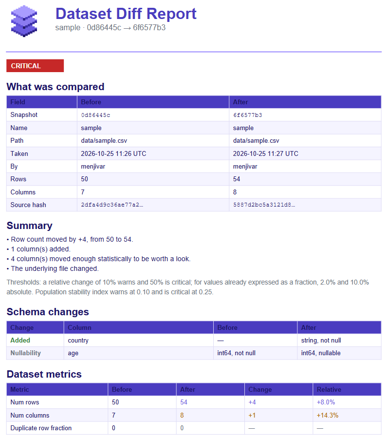

# Getting Started

This guide walks through the full `dstrack` workflow: initializing a store, taking your
first snapshot, and understanding how snapshots and lineage work.

## Prerequisites

- **Python 3.11 or later**
- Install the package:

```bash
pip install dstrack
```

- Verify the installation:

```bash
dstrack version
# 0.1.0
```

## 1. Initialize a store

`dstrack` keeps its history in a local store - a `.dstrack/` directory, conceptually
similar to git's `.git/`. Create one at the root of your project:

```bash
dstrack init
```

```text
ℹ Generating local store structure at /path/to/.dstrack.
✔ Finished creating local store: /path/to/.dstrack
```

This creates:

```text
.dstrack/
├── datasets/     # one directory per tracked dataset
└── .gitignore    # ignores the local .cache/ directory
```

A few things worth knowing:

- The store is discovered by walking **up** the directory tree from where you run a
  command, so you can `track` datasets from any subdirectory of your project.
- Set the `DSTRACK_ROOT_PATH` environment variable to point at a store elsewhere.
- Re-running `init` where a store already exists fails by design. Pass `--allow-exists`
  to turn that into a warning instead:

```bash
dstrack init --allow-exists
```

```text
⚡ Local store path already exists: /path/to/.dstrack
```

## 2. Track a dataset

Tracking reads a data file, computes a **snapshot**, and stores it. Create a small
`data.csv` to follow along:

```csv
id,name,value
1,alpha,10.5
2,beta,20.0
3,gamma,15.25
```

Then snapshot it:

```bash
dstrack track data.csv
```

```text
ℹ Reading data.csv and computing snapshot...
✔ Snapshot <snapshot-uuid> written (new dataset, dataset <dataset-uuid>).
ℹ Stored at /path/to/.dstrack/datasets/<dataset-uuid>/snapshots/<snapshot-uuid>.json
```

A snapshot is an immutable record of the dataset's state at that moment. It captures:

- **Schema** - column names and inferred types, plus an order-independent `schema_hash`
- **Content fingerprint** - a SHA-256 hash of the source file
- **Per-column statistics** - counts, ranges, null rates, and distribution summaries

The dataset name defaults to the file stem (`data` above); override it with `--name`.

## 3. Snapshots and lineage

Run `track` again on the **same path** and `dstrack` recognizes the dataset, extending its
lineage rather than starting a new one. The new snapshot points back to the previous one
via its `parent_snapshot_id`:

```bash
dstrack track data.csv
```

```text
✔ Snapshot <snapshot-uuid> written (continued lineage, dataset <dataset-uuid>).
```

If you rename or move a dataset file, the recorded path no longer matches, so `dstrack`
would start a new lineage. To keep the history connected, continue the existing dataset
explicitly with `--dataset-id`:

```bash
dstrack track renamed.csv --dataset-id <dataset-uuid>
```
For more information on what `dstrack track` allows you to do, simply ask for the help:

```bash
dstrack track --help
```

## 4. View a dataset's history

`dstrack log` shows a dataset's snapshots as a timeline, newest first. Point it at the
dataset's path, and `dstrack` works out which dataset that is:

```bash
dstrack log data.csv
```

<pre class="rich-terminal"><code><span style="color: #008080; text-decoration-color: #008080; font-weight: bold">●</span> <span style="color: #808000; text-decoration-color: #808000; font-weight: bold">e9d6f0d7</span>  <span style="font-weight: bold">sample</span><span style="color: #008080; text-decoration-color: #008080; font-weight: bold">  HEAD</span>
<span style="color: #7fbfbf; text-decoration-color: #7fbfbf">│</span> 1 week ago<span style="color: #7f7f7f; text-decoration-color: #7f7f7f">  by </span>menjivar
<span style="color: #7fbfbf; text-decoration-color: #7fbfbf">│</span> <span style="font-weight: bold">54</span><span style="color: #7f7f7f; text-decoration-color: #7f7f7f"> rows</span> <span style="color: #008000; text-decoration-color: #008000">+4</span>   <span style="font-weight: bold">8</span><span style="color: #7f7f7f; text-decoration-color: #7f7f7f"> cols</span> <span style="color: #008000; text-decoration-color: #008000">+1</span>
<span style="color: #7fbfbf; text-decoration-color: #7fbfbf">│</span> <span style="color: #7f7f7f; text-decoration-color: #7f7f7f">data/sample.csv        </span>
<span style="color: #7fbfbf; text-decoration-color: #7fbfbf">│</span>  
<span style="color: #008080; text-decoration-color: #008080">●</span> <span style="color: #808000; text-decoration-color: #808000; font-weight: bold">e83517d4</span>  <span style="font-weight: bold">sample</span>  
<span style="color: #7fbfbf; text-decoration-color: #7fbfbf"> </span> 1 week ago<span style="color: #7f7f7f; text-decoration-color: #7f7f7f">  by </span>menjivar
<span style="color: #7fbfbf; text-decoration-color: #7fbfbf"> </span> <span style="font-weight: bold">50</span><span style="color: #7f7f7f; text-decoration-color: #7f7f7f"> rows</span>   <span style="font-weight: bold">7</span><span style="color: #7f7f7f; text-decoration-color: #7f7f7f"> cols</span>  
<span style="color: #7fbfbf; text-decoration-color: #7fbfbf"> </span> <span style="color: #7f7f7f; text-decoration-color: #7f7f7f">data/sample.csv        </span>
</code></pre>

Each node is one snapshot, showing how its row and column counts changed from the
snapshot below it. `HEAD` marks the latest.

This is also how you find the `--dataset-id` the rename above needs: pass the path while
it still matches, or list what the store knows by asking for a dataset that isn't there.
A dataset id works anywhere a path does, and keeps working after the file is renamed,
moved, or deleted:

```bash
dstrack log <dataset-uuid>
```

Useful flags: `-n 5` to show only the latest few, `--oneline` to condense each snapshot
to a single line, and `--reverse` to read oldest-first.

## 5. Compare two snapshots

`dstrack log` says *that* a dataset changed. `dstrack diff` says *what* changed. Point it
at the dataset and it compares the latest snapshot against the one before it:

```bash
dstrack diff data.csv
```

The output puts the two snapshots side by side and colors each difference by how much it
should worry you: the schema changes first, then the dataset's own numbers, then every
column whose statistics moved, with a distribution-shift score when available.
For a new column, the shift is shown as `—` because there is no baseline distribution.

Any of these name a side, so you can compare whichever two you mean:

```bash
dstrack diff a587afd9 0c82297f    # two snapshots, by the short ids `log` shows
dstrack diff --from 0c82297f     # that snapshot against where the dataset stands now
dstrack diff customers.csv orders.csv   # the latest snapshot of two datasets
```

Useful flags: `--oneline` for a single line, `--all` to include what did not change, and
`--sensitivity low|normal|high` to move the thresholds that decide what counts as a
significant shift.

For a pipeline, `--json` prints the whole comparison as structured data instead of a
table:

```bash
dstrack diff data.csv --json --yes > diff.json
```

### A shareable report

With the optional `report` extra installed, `--pdf` also writes a formatted report of the
same comparison - the kind of thing to attach to a review:

```bash
pip install 'dstrack[report]'
dstrack diff data.csv --pdf diff-report.pdf
```

### From Python

The comparison is a library function, not just a command. It takes two snapshot payloads
as plain dictionaries, so it works on snapshots read out of a store and on ones you built
yourself:

```python
from dstrack.diff import diff_snapshots
from dstrack.paths import resolve_store_root
from dstrack.store import read_snapshot

store_root = resolve_store_root()
old = read_snapshot("<dataset-uuid>", "<older-snapshot-uuid>", store_root=store_root)
new = read_snapshot("<dataset-uuid>", "<newer-snapshot-uuid>", store_root=store_root)

result = diff_snapshots(old, new)
print(result.severity, result.summary)
for column in result.columns:
    if column.distribution_shift is not None:
        print(column.name, column.distribution_shift.score)
```

<details class="example" open>
<summary>Exemplary bash diff output</summary>
<pre class="rich-terminal"><code><span style="color: #800000; text-decoration-color: #800000; font-weight: bold">╭────────────────── dstrack diff ───────────────────╮</span>
<span style="color: #800000; text-decoration-color: #800000; font-weight: bold">│</span> <span style="color: #7f7f7f; text-decoration-color: #7f7f7f">          before         </span>  <span style="color: #7f7f7f; text-decoration-color: #7f7f7f">after                 </span> <span style="color: #800000; text-decoration-color: #800000; font-weight: bold">│</span>
<span style="color: #800000; text-decoration-color: #800000; font-weight: bold">│</span> <span style="color: #7f7f7f; text-decoration-color: #7f7f7f">snapshot  </span><span style="color: #808000; text-decoration-color: #808000; font-weight: bold">e83517d4       </span>  <span style="color: #808000; text-decoration-color: #808000; font-weight: bold">e9d6f0d7              </span> <span style="color: #800000; text-decoration-color: #800000; font-weight: bold">│</span>
<span style="color: #800000; text-decoration-color: #800000; font-weight: bold">│</span> <span style="color: #7f7f7f; text-decoration-color: #7f7f7f">name      </span><span style="font-weight: bold">sample         </span>  <span style="font-weight: bold">sample                </span> <span style="color: #800000; text-decoration-color: #800000; font-weight: bold">│</span>
<span style="color: #800000; text-decoration-color: #800000; font-weight: bold">│</span> <span style="color: #7f7f7f; text-decoration-color: #7f7f7f">path      data/sample.csv</span>  <span style="color: #7f7f7f; text-decoration-color: #7f7f7f">data/sample.csv       </span> <span style="color: #800000; text-decoration-color: #800000; font-weight: bold">│</span>
<span style="color: #800000; text-decoration-color: #800000; font-weight: bold">│</span> <span style="color: #7f7f7f; text-decoration-color: #7f7f7f">taken     </span>1 week ago       1 week ago             <span style="color: #800000; text-decoration-color: #800000; font-weight: bold">│</span>
<span style="color: #800000; text-decoration-color: #800000; font-weight: bold">│</span> <span style="color: #7f7f7f; text-decoration-color: #7f7f7f">by        </span>menjivar         menjivar               <span style="color: #800000; text-decoration-color: #800000; font-weight: bold">│</span>
<span style="color: #800000; text-decoration-color: #800000; font-weight: bold">│</span> <span style="color: #7f7f7f; text-decoration-color: #7f7f7f">rows      </span><span style="font-weight: bold">50             </span>  <span style="font-weight: bold">54                    </span> <span style="color: #800000; text-decoration-color: #800000; font-weight: bold">│</span>
<span style="color: #800000; text-decoration-color: #800000; font-weight: bold">│</span> <span style="color: #7f7f7f; text-decoration-color: #7f7f7f">columns   </span><span style="font-weight: bold">7              </span>  <span style="font-weight: bold">8                     </span> <span style="color: #800000; text-decoration-color: #800000; font-weight: bold">│</span>
<span style="color: #800000; text-decoration-color: #800000; font-weight: bold">│</span> <span style="color: #7f7f7f; text-decoration-color: #7f7f7f">source    2dfa4d9c36ae…  </span>  <span style="color: #7f7f7f; text-decoration-color: #7f7f7f">1746ddc049a2…</span><span style="color: #bf7f7f; text-decoration-color: #bf7f7f; font-weight: bold">  changed</span> <span style="color: #800000; text-decoration-color: #800000; font-weight: bold">│</span>
<span style="color: #800000; text-decoration-color: #800000; font-weight: bold">╰───────────────────  CRITICAL  ────────────────────╯</span>

<span style="font-weight: bold">Schema</span>
<span style="font-weight: bold">   </span> <span style="font-weight: bold"> column      </span> <span style="font-weight: bold"> before              </span> <span style="font-weight: bold"> after           </span>
─────────────────────────────────────────────────────────
 <span style="color: #008000; text-decoration-color: #008000">+</span>   <span style="color: #808000; text-decoration-color: #808000">country    </span>   <span style="color: #7f7f7f; text-decoration-color: #7f7f7f">—                  </span>   string<span style="color: #7f7f7f; text-decoration-color: #7f7f7f"> not null</span>
 <span style="color: #7f7f7f; text-decoration-color: #7f7f7f">~</span>   <span style="color: #008080; text-decoration-color: #008080">age        </span>   int64<span style="color: #7f7f7f; text-decoration-color: #7f7f7f"> not null</span>        int64<span style="color: #7f7f7f; text-decoration-color: #7f7f7f"> null</span>  
 <span style="color: #7f7f7f; text-decoration-color: #7f7f7f">~</span>   <span style="color: #008080; text-decoration-color: #008080">signup_date</span>   datetime64<span style="color: #7f7f7f; text-decoration-color: #7f7f7f"> not null</span>   datetime64<span style="color: #7f7f7f; text-decoration-color: #7f7f7f"> null</span>

<span style="font-weight: bold">Dataset</span>
<span style="color: #008080; text-decoration-color: #008080">•</span>  <span style="color: #7f7f7f; text-decoration-color: #7f7f7f">num rows     50</span>  <span style="color: #008080; text-decoration-color: #008080">54</span>  <span style="color: #008000; text-decoration-color: #008000"> +4</span><span style="color: #7fbf7f; text-decoration-color: #7fbf7f"> (+8.0%)</span>
<span style="color: #808000; text-decoration-color: #808000">⚠</span>  <span style="color: #7f7f7f; text-decoration-color: #7f7f7f">num columns   7</span>  <span style="color: #808000; text-decoration-color: #808000"> 8</span>  <span style="color: #008000; text-decoration-color: #008000">+1</span><span style="color: #7fbf7f; text-decoration-color: #7fbf7f"> (+14.3%)</span>

<span style="font-weight: bold">Column sets</span>
<span style="color: #808000; text-decoration-color: #808000">⚠</span>  <span style="color: #7f7f7f; text-decoration-color: #7f7f7f">constant columns   </span><span style="color: #008000; text-decoration-color: #008000">+is_active</span>  
<span style="color: #808000; text-decoration-color: #808000">⚠</span>  <span style="color: #7f7f7f; text-decoration-color: #7f7f7f">high null columns  </span><span style="color: #008000; text-decoration-color: #008000">+signup_date</span>

<span style="font-weight: bold">Columns</span>
<span style="color: #7f7f7f; text-decoration-color: #7f7f7f">  Numeric columns</span>
<span style="font-weight: bold">    </span> <span style="font-weight: bold"> column    </span> <span style="font-weight: bold">       nulls </span> <span style="font-weight: bold">          mean </span> <span style="font-weight: bold">           std </span> <span style="font-weight: bold">           p50 </span> <span style="font-weight: bold">           min </span> <span style="font-weight: bold">           max </span> <span style="font-weight: bold">    uniq </span> <span style="font-weight: bold"> shift     </span>
────────────────────────────────────────────────────────────────────────────────────────────────────────────────────────────────────
 <span style="color: #808000; text-decoration-color: #808000">⚠ </span>   <span style="font-weight: bold">id       </span>   <span style="color: #7f7f7f; text-decoration-color: #7f7f7f">          0</span>   <span style="color: #7f7f7f; text-decoration-color: #7f7f7f"> 25.5 → </span><span style="color: #bfbf7f; text-decoration-color: #bfbf7f">29.22</span>   <span style="color: #7f7f7f; text-decoration-color: #7f7f7f">14.43 → </span><span style="color: #bfbf7f; text-decoration-color: #bfbf7f">16.76</span>   <span style="color: #7f7f7f; text-decoration-color: #7f7f7f">  25.5 → </span><span style="color: #bfbf7f; text-decoration-color: #bfbf7f">29.5</span>   <span style="color: #7f7f7f; text-decoration-color: #7f7f7f">            1</span>   <span style="color: #7f7f7f; text-decoration-color: #7f7f7f">      50 → </span><span style="color: #bfbf7f; text-decoration-color: #bfbf7f">57</span>   <span style="color: #7f7f7f; text-decoration-color: #7f7f7f">50 → </span><span style="color: #7fbfbf; text-decoration-color: #7fbfbf">54</span>   <span style="color: #808000; text-decoration-color: #808000">PSI 0.22 </span>
 <span style="color: #808000; text-decoration-color: #808000">⚠ </span>   <span style="font-weight: bold">age      </span>   <span style="color: #7f7f7f; text-decoration-color: #7f7f7f">0 → </span><span style="color: #bfbf7f; text-decoration-color: #bfbf7f">0.09259</span>   <span style="color: #7f7f7f; text-decoration-color: #7f7f7f">44.14 → </span><span style="color: #7fbfbf; text-decoration-color: #7fbfbf">44.94</span>   <span style="color: #7f7f7f; text-decoration-color: #7f7f7f">18.31 → </span><span style="color: #7fbfbf; text-decoration-color: #7fbfbf">17.45</span>   <span style="color: #7f7f7f; text-decoration-color: #7f7f7f">    37.5 → </span><span style="color: #7fbfbf; text-decoration-color: #7fbfbf">39</span>   <span style="color: #7f7f7f; text-decoration-color: #7f7f7f">           18</span>   <span style="color: #7f7f7f; text-decoration-color: #7f7f7f">           75</span>   <span style="color: #7f7f7f; text-decoration-color: #7f7f7f">33 → </span><span style="color: #7fbfbf; text-decoration-color: #7fbfbf">35</span>   <span style="color: #808000; text-decoration-color: #808000">PSI 0.10 </span>
 <span style="color: #800000; text-decoration-color: #800000; font-weight: bold">❗</span>   <span style="font-weight: bold">balance  </span>   <span style="color: #7f7f7f; text-decoration-color: #7f7f7f">          0</span>   <span style="color: #7f7f7f; text-decoration-color: #7f7f7f">1,235 → </span><span style="color: #bfbf7f; text-decoration-color: #bfbf7f">1,678</span>   <span style="color: #7f7f7f; text-decoration-color: #7f7f7f">684.5 → </span><span style="color: #bfbf7f; text-decoration-color: #bfbf7f">920.2</span>   <span style="color: #7f7f7f; text-decoration-color: #7f7f7f">1,226 → </span><span style="color: #bfbf7f; text-decoration-color: #bfbf7f">1,748</span>   <span style="color: #7f7f7f; text-decoration-color: #7f7f7f">97.28 → </span><span style="color: #bfbf7f; text-decoration-color: #bfbf7f">80.57</span>   <span style="color: #7f7f7f; text-decoration-color: #7f7f7f">2,403 → </span><span style="color: #bfbf7f; text-decoration-color: #bfbf7f">3,190</span>   <span style="color: #7f7f7f; text-decoration-color: #7f7f7f">50 → </span><span style="color: #7fbfbf; text-decoration-color: #7fbfbf">54</span>   <span style="color: #800000; text-decoration-color: #800000; font-weight: bold">PSI 0.84 </span>
 <span style="color: #800000; text-decoration-color: #800000; font-weight: bold">❗</span>   <span style="font-weight: bold">is_active</span>   <span style="color: #7f7f7f; text-decoration-color: #7f7f7f">          0</span>   <span style="color: #7f7f7f; text-decoration-color: #7f7f7f">      0.5 → </span><span style="color: #bf7f7f; text-decoration-color: #bf7f7f; font-weight: bold">1</span>   <span style="color: #7f7f7f; text-decoration-color: #7f7f7f">      0.5 → </span><span style="color: #bf7f7f; text-decoration-color: #bf7f7f; font-weight: bold">0</span>   <span style="color: #7f7f7f; text-decoration-color: #7f7f7f">      0.5 → </span><span style="color: #bf7f7f; text-decoration-color: #bf7f7f; font-weight: bold">1</span>   <span style="color: #7f7f7f; text-decoration-color: #7f7f7f">        0 → </span><span style="color: #bfbf7f; text-decoration-color: #bfbf7f">1</span>   <span style="color: #7f7f7f; text-decoration-color: #7f7f7f">            1</span>   <span style="color: #7f7f7f; text-decoration-color: #7f7f7f">  2 → </span><span style="color: #bf7f7f; text-decoration-color: #bf7f7f; font-weight: bold">1</span>   <span style="color: #800000; text-decoration-color: #800000; font-weight: bold">pctl 1.00</span>
<span style="color: #7f7f7f; text-decoration-color: #7f7f7f">  Text columns</span>
<span style="font-weight: bold">   </span> <span style="font-weight: bold"> column        </span> <span style="font-weight: bold"> nulls </span> <span style="font-weight: bold">    uniq </span> <span style="font-weight: bold"> coverage </span> <span style="font-weight: bold">       avg len </span> <span style="font-weight: bold"> shift                              </span>
─────────────────────────────────────────────────────────────────────────────────────────────────────
 <span style="color: #008080; text-decoration-color: #008080">•</span>   <span style="font-weight: bold">name         </span>   <span style="color: #7f7f7f; text-decoration-color: #7f7f7f">    0</span>   <span style="color: #7f7f7f; text-decoration-color: #7f7f7f">28 → </span><span style="color: #7fbfbf; text-decoration-color: #7fbfbf">30</span>   <span style="color: #7f7f7f; text-decoration-color: #7f7f7f">       1</span>   <span style="color: #7f7f7f; text-decoration-color: #7f7f7f">13.88 → </span><span style="color: #7fbfbf; text-decoration-color: #7fbfbf">13.83</span>   <span style="color: #008080; text-decoration-color: #008080">TVD 0.08 </span><span style="color: #008000; text-decoration-color: #008000">+Ada Turing</span><span style="color: #008080; text-decoration-color: #008080"> </span><span style="color: #008000; text-decoration-color: #008000">+Alan Johnson</span>
 <span style="color: #808000; text-decoration-color: #808000">⚠</span>   <span style="font-weight: bold">plan         </span>   <span style="color: #7f7f7f; text-decoration-color: #7f7f7f">    0</span>   <span style="color: #7f7f7f; text-decoration-color: #7f7f7f">      3</span>   <span style="color: #7f7f7f; text-decoration-color: #7f7f7f">       1</span>   <span style="color: #7f7f7f; text-decoration-color: #7f7f7f">  5.9 → </span><span style="color: #bfbf7f; text-decoration-color: #bfbf7f">6.944</span>   <span style="color: #808000; text-decoration-color: #808000">TVD 0.16                          </span>
 <span style="color: #008080; text-decoration-color: #008080">•</span>   <span style="font-weight: bold">country</span><span style="color: #008000; text-decoration-color: #008000; font-weight: bold"> (new)</span>   <span style="color: #7f7f7f; text-decoration-color: #7f7f7f">— → </span><span style="color: #7fbfbf; text-decoration-color: #7fbfbf">0</span>   <span style="color: #7f7f7f; text-decoration-color: #7f7f7f">  — → </span><span style="color: #7fbfbf; text-decoration-color: #7fbfbf">5</span>   <span style="color: #7f7f7f; text-decoration-color: #7f7f7f">   — → </span><span style="color: #7fbfbf; text-decoration-color: #7fbfbf">1</span>   <span style="color: #7f7f7f; text-decoration-color: #7f7f7f">        — → </span><span style="color: #7fbfbf; text-decoration-color: #7fbfbf">2</span>   <span style="color: #7f7f7f; text-decoration-color: #7f7f7f">—                                 </span>
<span style="color: #7f7f7f; text-decoration-color: #7f7f7f">  Datetime columns</span>
<span style="font-weight: bold">    </span> <span style="font-weight: bold"> column      </span> <span style="font-weight: bold">      nulls </span> <span style="font-weight: bold"> range (d) </span>
───────────────────────────────────────────
 <span style="color: #800000; text-decoration-color: #800000; font-weight: bold">❗</span>   <span style="font-weight: bold">signup_date</span>   <span style="color: #7f7f7f; text-decoration-color: #7f7f7f">0 → </span><span style="color: #bf7f7f; text-decoration-color: #bf7f7f; font-weight: bold">0.7407</span>   <span style="color: #7f7f7f; text-decoration-color: #7f7f7f">360 → </span><span style="color: #7fbfbf; text-decoration-color: #7fbfbf">353</span>

<span style="font-weight: bold">Other column changes</span>
<span style="color: #008080; text-decoration-color: #008080">• </span>  <span style="font-weight: bold">id         </span>  <span style="color: #7f7f7f; text-decoration-color: #7f7f7f">percentiles.p5                                 3.45 → </span><span style="color: #7fbfbf; text-decoration-color: #7fbfbf">3.65</span>  <span style="color: #008000; text-decoration-color: #008000">      +0.2</span><span style="color: #7fbf7f; text-decoration-color: #7fbf7f"> (+5.8%)</span>
<span style="color: #008080; text-decoration-color: #008080">• </span>  <span style="font-weight: bold">id         </span>  <span style="color: #7f7f7f; text-decoration-color: #7f7f7f">percentiles.p25                               13.25 → </span><span style="color: #7fbfbf; text-decoration-color: #7fbfbf">14.5</span>  <span style="color: #008000; text-decoration-color: #008000">     +1.25</span><span style="color: #7fbf7f; text-decoration-color: #7fbf7f"> (+9.4%)</span>
<span style="color: #808000; text-decoration-color: #808000">⚠ </span>  <span style="font-weight: bold">id         </span>  <span style="color: #7f7f7f; text-decoration-color: #7f7f7f">percentiles.p75                              37.75 → </span><span style="color: #bfbf7f; text-decoration-color: #bfbf7f">43.75</span>  <span style="color: #008000; text-decoration-color: #008000">       +6</span><span style="color: #7fbf7f; text-decoration-color: #7fbf7f"> (+15.9%)</span>
<span style="color: #808000; text-decoration-color: #808000">⚠ </span>  <span style="font-weight: bold">id         </span>  <span style="color: #7f7f7f; text-decoration-color: #7f7f7f">percentiles.p95                              47.55 → </span><span style="color: #bfbf7f; text-decoration-color: #bfbf7f">54.35</span>  <span style="color: #008000; text-decoration-color: #008000">     +6.8</span><span style="color: #7fbf7f; text-decoration-color: #7fbf7f"> (+14.3%)</span>
<span style="color: #808000; text-decoration-color: #808000">⚠ </span>  <span style="font-weight: bold">id         </span>  <span style="color: #7f7f7f; text-decoration-color: #7f7f7f">percentiles.p99                              49.51 → </span><span style="color: #bfbf7f; text-decoration-color: #bfbf7f">56.47</span>  <span style="color: #008000; text-decoration-color: #008000">    +6.96</span><span style="color: #7fbf7f; text-decoration-color: #7fbf7f"> (+14.1%)</span>
<span style="color: #808000; text-decoration-color: #808000">⚠ </span>  <span style="font-weight: bold">age        </span>  <span style="color: #7f7f7f; text-decoration-color: #7f7f7f">null_count                                           0 → </span><span style="color: #bfbf7f; text-decoration-color: #bfbf7f">5</span>  <span style="color: #808000; text-decoration-color: #808000">                +5</span>
<span style="color: #008080; text-decoration-color: #008080">• </span>  <span style="font-weight: bold">age        </span>  <span style="color: #7f7f7f; text-decoration-color: #7f7f7f">percentiles.p5                                 20.9 → </span><span style="color: #7fbfbf; text-decoration-color: #7fbfbf">20.8</span>  <span style="color: #800000; text-decoration-color: #800000">      -0.1</span><span style="color: #bf7f7f; text-decoration-color: #bf7f7f"> (-0.5%)</span>
<span style="color: #008080; text-decoration-color: #008080">• </span>  <span style="font-weight: bold">age        </span>  <span style="color: #7f7f7f; text-decoration-color: #7f7f7f">percentiles.p25                                    29 → </span><span style="color: #7fbfbf; text-decoration-color: #7fbfbf">30</span>  <span style="color: #008000; text-decoration-color: #008000">        +1</span><span style="color: #7fbf7f; text-decoration-color: #7fbf7f"> (+3.4%)</span>
<span style="color: #008080; text-decoration-color: #008080">• </span>  <span style="font-weight: bold">age        </span>  <span style="color: #7f7f7f; text-decoration-color: #7f7f7f">percentiles.p75                                 60.75 → </span><span style="color: #7fbfbf; text-decoration-color: #7fbfbf">59</span>  <span style="color: #800000; text-decoration-color: #800000">     -1.75</span><span style="color: #bf7f7f; text-decoration-color: #bf7f7f"> (-2.9%)</span>
<span style="color: #808000; text-decoration-color: #808000">⚠ </span>  <span style="font-weight: bold">balance    </span>  <span style="color: #7f7f7f; text-decoration-color: #7f7f7f">percentiles.p5                               154.1 → </span><span style="color: #bfbf7f; text-decoration-color: #bfbf7f">179.6</span>  <span style="color: #008000; text-decoration-color: #008000">   +25.58</span><span style="color: #7fbf7f; text-decoration-color: #7fbf7f"> (+16.6%)</span>
<span style="color: #800000; text-decoration-color: #800000; font-weight: bold">❗</span>  <span style="font-weight: bold">balance    </span>  <span style="color: #7f7f7f; text-decoration-color: #7f7f7f">percentiles.p25                              601.7 → </span><span style="color: #bf7f7f; text-decoration-color: #bf7f7f; font-weight: bold">992.7</span>  <span style="color: #008000; text-decoration-color: #008000">     +391</span><span style="color: #7fbf7f; text-decoration-color: #7fbf7f"> (+65.0%)</span>
<span style="color: #808000; text-decoration-color: #808000">⚠ </span>  <span style="font-weight: bold">balance    </span>  <span style="color: #7f7f7f; text-decoration-color: #7f7f7f">percentiles.p75                              1,828 → </span><span style="color: #bfbf7f; text-decoration-color: #bfbf7f">2,504</span>  <span style="color: #008000; text-decoration-color: #008000">     +676</span><span style="color: #7fbf7f; text-decoration-color: #7fbf7f"> (+37.0%)</span>
<span style="color: #808000; text-decoration-color: #808000">⚠ </span>  <span style="font-weight: bold">balance    </span>  <span style="color: #7f7f7f; text-decoration-color: #7f7f7f">percentiles.p95                              2,237 → </span><span style="color: #bfbf7f; text-decoration-color: #bfbf7f">2,965</span>  <span style="color: #008000; text-decoration-color: #008000">   +727.2</span><span style="color: #7fbf7f; text-decoration-color: #7fbf7f"> (+32.5%)</span>
<span style="color: #808000; text-decoration-color: #808000">⚠ </span>  <span style="font-weight: bold">balance    </span>  <span style="color: #7f7f7f; text-decoration-color: #7f7f7f">percentiles.p99                              2,385 → </span><span style="color: #bfbf7f; text-decoration-color: #bfbf7f">3,164</span>  <span style="color: #008000; text-decoration-color: #008000">   +779.3</span><span style="color: #7fbf7f; text-decoration-color: #7fbf7f"> (+32.7%)</span>
<span style="color: #808000; text-decoration-color: #808000">⚠ </span>  <span style="font-weight: bold">is_active  </span>  <span style="color: #7f7f7f; text-decoration-color: #7f7f7f">percentiles.p5                                       0 → </span><span style="color: #bfbf7f; text-decoration-color: #bfbf7f">1</span>  <span style="color: #008000; text-decoration-color: #008000">                +1</span>
<span style="color: #808000; text-decoration-color: #808000">⚠ </span>  <span style="font-weight: bold">is_active  </span>  <span style="color: #7f7f7f; text-decoration-color: #7f7f7f">percentiles.p25                                      0 → </span><span style="color: #bfbf7f; text-decoration-color: #bfbf7f">1</span>  <span style="color: #008000; text-decoration-color: #008000">                +1</span>
<span style="color: #008080; text-decoration-color: #008080">• </span>  <span style="font-weight: bold">country    </span>  <span style="color: #7f7f7f; text-decoration-color: #7f7f7f">null_count                                           — → </span><span style="color: #7fbfbf; text-decoration-color: #7fbfbf">0</span>  
<span style="color: #008080; text-decoration-color: #008080">• </span>  <span style="font-weight: bold">country    </span>  <span style="color: #7f7f7f; text-decoration-color: #7f7f7f">min_char_length                                      — → </span><span style="color: #7fbfbf; text-decoration-color: #7fbfbf">2</span>  
<span style="color: #008080; text-decoration-color: #008080">• </span>  <span style="font-weight: bold">country    </span>  <span style="color: #7f7f7f; text-decoration-color: #7f7f7f">max_char_length                                      — → </span><span style="color: #7fbfbf; text-decoration-color: #7fbfbf">2</span>  
<span style="color: #008080; text-decoration-color: #008080">• </span>  <span style="font-weight: bold">country    </span>  <span style="color: #7f7f7f; text-decoration-color: #7f7f7f">avg_token_count                                      — → </span><span style="color: #7fbfbf; text-decoration-color: #7fbfbf">1</span>  
<span style="color: #008080; text-decoration-color: #008080">• </span>  <span style="font-weight: bold">country    </span>  <span style="color: #7f7f7f; text-decoration-color: #7f7f7f">min_token_count                                      — → </span><span style="color: #7fbfbf; text-decoration-color: #7fbfbf">1</span>  
<span style="color: #008080; text-decoration-color: #008080">• </span>  <span style="font-weight: bold">country    </span>  <span style="color: #7f7f7f; text-decoration-color: #7f7f7f">max_token_count                                      — → </span><span style="color: #7fbfbf; text-decoration-color: #7fbfbf">1</span>  
<span style="color: #808000; text-decoration-color: #808000">⚠ </span>  <span style="font-weight: bold">signup_date</span>  <span style="color: #7f7f7f; text-decoration-color: #7f7f7f">null_count                                          0 → </span><span style="color: #bfbf7f; text-decoration-color: #bfbf7f">40</span>  <span style="color: #808000; text-decoration-color: #808000">               +40</span>
<span style="color: #008080; text-decoration-color: #008080">• </span>  <span style="font-weight: bold">signup_date</span>  <span style="color: #7f7f7f; text-decoration-color: #7f7f7f">min              2023-01-02 00:00:00 → </span><span style="color: #7fbfbf; text-decoration-color: #7fbfbf">2023-01-09 00:00:00</span>  <span style="color: #008000; text-decoration-color: #008000">+6.048e+05</span><span style="color: #7fbf7f; text-decoration-color: #7fbf7f"> (+0.0%)</span>

<span style="font-weight: bold">+4 rows</span>   <span style="color: #008000; text-decoration-color: #008000">+1 columns</span>   <span style="color: #808000; text-decoration-color: #808000">6 columns drifted</span>   <span style="color: #808000; text-decoration-color: #808000">+1 constant columns</span>   <span style="color: #808000; text-decoration-color: #808000">+1 high null columns</span>
</code></pre>
</details>

??? example "Exemplary PDF diff report"
    <figure markdown="span">
    
    <figcaption>Exemplary PDF report (1st page only)</figcaption>
    </figure>

See the [diff API reference](API/diff.md) for the full result type.

## Where snapshots live

Each snapshot is a JSON file under its dataset's directory:

```text
.dstrack/
├── .cache/
│   └── index.db          # not committed; rebuilt on demand
└── datasets/
    └── <dataset-uuid>/
        ├── HEAD          # the latest snapshot
        ├── log.jsonl     # append-only history, one line per snapshot
        └── snapshots/
            └── <snapshot-uuid>.json
```

`.dstrack/` is plain text and safe to commit alongside your code, giving you a versioned
audit trail of how your datasets evolved. The exception is `.cache/`, which holds only
what can be derived from the logs beside it, and is gitignored for you.

## Benchmarking (optional)

`dstrack` ships a second command, `dstrack-benchmark`, that generates a synthetic CSV and
measures snapshot-creation performance - handy for understanding overhead on large files:

```bash
dstrack-benchmark run --rows 100000
```

This command creates a synthetic file in a temporary location to measure performance.

## What's next

Comparing a working file against its latest snapshot without taking a new one
(`dstrack status`), and failing CI when data drifts (`--fail-on-drift`), are planned. See
the [roadmap](roadmap.md) for the full picture.
