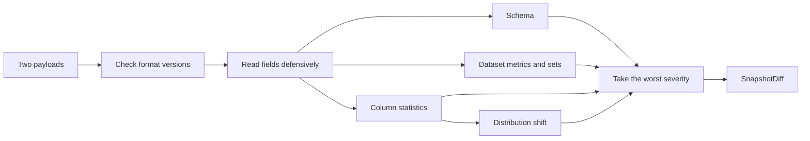

# Understanding the diff engine

This tutorial explains how `dstrack` decides what changed between two snapshots, how to
read the result, and how to avoid the mistakes that produce a misleading one. It assumes
you have read [Getting Started](../getting_started.md).

!!! tip "The most important thing to know"

    The engine accepts incomplete input on purpose. A missing or malformed field becomes
    "not recorded" instead of an error, so **a bad payload usually gives you a quiet diff,
    not a crash**. Most of the advice below is about noticing when that has happened.

## 1. A first comparison

The engine takes two snapshot payloads, which are plain dictionaries. This example builds
them by hand so that every number is visible; the real ones come from a store.

```python
import copy

from dstrack.diff import diff_snapshots

old = {
    "format_version": "1",
    "num_rows": 1000,
    "columns": [
        {"name": "age", "dtype": "int64", "nullable": False},
        {"name": "city", "dtype": "string", "nullable": True},
    ],
    "column_stats": {
        "age": {
            "null_count": 0,
            "null_fraction": 0.0,
            "mean": 30.0,
            "histogram": {
                "bin_edges": [18.0, 30.0, 42.0, 66.0],
                "counts": [400, 500, 100],
            },
        },
        "city": {
            "null_count": 100,
            "null_fraction": 0.1,
            "top_values": {"NY": 540, "LA": 270},
            "top_values_coverage": 0.9,  # 810 of the 900 non-null values
        },
    },
}

new = copy.deepcopy(old)
new["column_stats"]["age"]["mean"] = 36.0
new["column_stats"]["age"]["histogram"]["counts"] = [200, 500, 300]
new["column_stats"]["city"]["top_values"] = {"NY": 360, "LA": 450}

result = diff_snapshots(old, new)  # the baseline always comes first

print(result.severity)
for column in result.columns:
    shift = column.distribution_shift
    print(column.name, column.severity, shift.method, round(shift.score, 3))
```

```text
critical
age critical psi 0.357
city warning top_values_tvd 0.2
```

`dstrack diff` runs this same function on two snapshots from your store.

## 2. How a comparison works



The format version check is the only deliberate refusal. After that, each kind of question
is answered in its own way.

### Schema: exact

A column is either in both lists or it is not, and its `dtype` either matches or it does
not. Nothing is thresholded, and the severities are fixed:

| Change | Severity |
|---|---|
| Column removed | `critical` |
| Column type changed | `critical` |
| Column added | `warning` |
| Column joined `constant_columns` or `high_null_columns` | `warning` |
| Nullability changed | `info` |
| Column left `constant_columns` or `high_null_columns` | `info` |
| Column order changed | none (listed in `schema.reordered`) |

A renamed column appears as one removal and one addition, so it is always `critical`.
Snapshots have no row-level identity, so the engine does not guess at renames.

### Scalars: judged by the kind of number

Every scalar is first checked against a tolerance. Numbers within `rel_tolerance` (0.1% by
default) count as unchanged. Anything that moved further is graded:

- **Counts and magnitudes**, such as `num_rows` or `mean`, are graded by relative change.
  A move away from exactly zero has no relative scale, and is always a `warning`.
- **Fractions**, namely `null_fraction`, `duplicate_row_fraction`, `top_values_coverage`
  and `near_duplicate_estimate`, are graded by absolute shift. A null fraction moving from
  0.001 to 0.002 has doubled, but it means almost nothing.
- **Datetime bounds** are compared as epoch seconds and get no relative tolerance, because
  a shift of days would otherwise be lost against a value that large.

A metric present on only one side is `info`: what was recorded changed, not the data.

### Distributions: one measure per column kind

| Column kind | Measure | Scale |
|---|---|---|
| Numeric | PSI over the histograms | 0 and up; 0.25 is already a major shift |
| Numeric, histogram unusable | Largest percentile move, divided by the baseline's p5-p95 spread | 0 and up |
| String | Total variation distance over the top values | 0 to 1 |
| Datetime, other | None | `distribution_shift` is `None` |

The population stability index (PSI) compares how much of a column falls in each histogram
bin. The two histograms rarely share edges, so counts are spread over a shared grid in
proportion to overlap. Total variation distance (TVD) is half the summed difference in
each category's share, with everything outside the top values treated as one extra
category.

These scales are not interchangeable, so always read a score together with its `method`.

### Severity folds upward

Each comparison is `unchanged`, `info`, `warning` or `critical`. A column is as serious as
its most serious measurement, and the diff is as serious as its most serious part.

See [ADR-0004](../decisions/0004-diff-semantics-and-severity.md) for the reasoning behind
these choices.

## 3. Reading a result

| Field | What it tells you |
|---|---|
| `severity` | The worst severity anywhere in the diff |
| `identical` | Every comparison was `unchanged` and no column was added, removed or redefined |
| `source_hash_equal` | Both sides recorded the same non-empty hash, so the bytes are the same |
| `same_dataset` | Both sides carry the same dataset id, or neither carries one |
| `schema` | Added, removed, retyped and reordered columns |
| `metrics`, `sets` | Dataset-level changes |
| `columns` | Per-column `metrics` and `distribution_shift` |
| `summary` | Headline counts, such as `columns_drifted` and `row_delta` |

`result.to_dict()` returns the same structure as JSON-ready data. New keys may be added
over time, but existing ones keep their meaning within a `diff_format_version`, so ignore
any key you do not recognize.

!!! warning "`identical` means no difference was *found*"

    It does not prove that the data is the same. These all report `identical=True`:

    - two empty payloads, since there was nothing to compare
    - a pure column reorder, which only shows up in `schema.reordered`
    - a change smaller than `rel_tolerance`, such as 1,000,000 rows becoming 1,000,500
    - edits that leave the recorded statistics the same

    Use `source_hash_equal` to ask whether the bytes are the same.

## 4. Choosing thresholds

The CLI offers three presets through `--sensitivity`. Each cell is the warning threshold
followed by the critical one:

| Measure | `low` | `normal` | `high` |
|---|---|---|---|
| Relative change | 0.25 / 1.00 | 0.10 / 0.50 | 0.02 / 0.10 |
| Fraction shift | 0.05 / 0.20 | 0.02 / 0.10 | 0.005 / 0.02 |
| PSI, TVD, percentile shift | 0.25 / 0.50 | 0.10 / 0.25 | 0.05 / 0.10 |

From Python, start from a preset and change only what you need:

```python
import dataclasses

from dstrack.diff import preset

options = dataclasses.replace(preset("high"), rel_tolerance=0.0, critical_psi=0.2)
result = diff_snapshots(old, new, options=options)
```

Three things to watch for, none of which the engine checks for you:

- **Thresholds are fractions.** `warn_pct_change=10` means 1000%, not 10%.
- **Keep `warn` below `critical`.** The critical band is tested first, so inverted values
  make the `warning` band unreachable.
- **Presets do not change `rel_tolerance`.** Even `high` ignores moves under 0.1%. Set it
  to `0.0` if every row counts.

## 5. Preventing errors

### Let dstrack build your payloads

Snapshots from `dstrack track` or `SnapshotBuilder` already satisfy every rule below, so
this is the most reliable way to avoid input errors:

```python
from dstrack.readers import CsvReader
from dstrack.snapshot import SnapshotBuilder

snapshot = SnapshotBuilder().build(
    CsvReader("data.csv"),
    dataset_name="customers",
    dataset_path="data.csv",
    created_by="alice",
)
```

### Call the function correctly

- **Pass dictionaries, not JSON text or paths.** Anything else raises `AttributeError`.
  Use `read_snapshot` or `json.loads` first.
- **Put the baseline first.** Swapping the sides swaps added and removed columns and
  changes every percentage, because change is measured against the baseline: going from
  1,000 to 2,000 rows is +100%, but the reverse is -50%.
- **Pass dataset ids when you have them**, using `old_dataset_id` and `new_dataset_id`.
  Without them, `same_dataset` is `True` for any two payloads, even unrelated ones.
  Comparing different datasets is allowed, so check this field if it matters to you.

### If you build payloads by hand

The field definitions are in `src/dstrack/schemas/snapshot_v<#>.json`. Validating against
that file as it stands will fail, because it requires a few fields (such as
`near_duplicate_estimate`) that the builders do not produce yet.

| Field | Rule | If you break it |
|---|---|---|
| Key names | Spell them exactly; `numrows` is not `num_rows` | Treated as not recorded, with no error |
| Numbers | Real numbers, not `"1000"`, `true` or `NaN` | Treated as not recorded, with no error |
| `format_version` | The string `"1"`, or leave it out | An unknown string raises `IncompatibleSnapshotError`; the integer `1` is ignored |
| `num_rows` | Always include it | String columns lose their normalization; `row_delta` is `None` |
| `columns` and `column_stats` | List the same columns in both | A column that only has stats is not reported as added. With stats on one side it reads as `info`; with stats on both it is graded normally, up to `critical` |
| `dtype` | Use the same spelling on both sides | `"str"` against `"string"`, or a `dtype` on one side only, is a `critical` type change |
| Stat keys | Use one kind of statistics per column, the same on both sides | The kind comes from the keys, so `top_values` on one side and `mean` on the other is a `critical` kind change |
| `null_fraction` | Always include it for columns with nulls | Read as 0, which then contradicts `top_values_coverage` |
| `top_values_coverage` | `sum(top_values) / non-null values`, **not** divided by all rows | Top values are refused and no score is produced |
| Rounding | Do not round `top_values_coverage` or `null_fraction` | Only 1e-6 of disagreement is allowed, so `0.3333` is refused |
| `histogram.bin_edges` | Strictly ascending, one more edge than `counts`, at least two bins | Wrong lengths, or a last edge not above the first, fall back to percentiles; **other out-of-order edges are not detected and give a false score** |
| `histogram.counts` | Non-negative | Can raise `ValueError: math domain error` or give a false score |
| `percentiles` | Nested as `{"p5": ..., "p50": ...}`, not as top-level keys | Not read, so there is no fallback measure |
| Datetime `min`, `max` | ISO-8601 text, ideally with an offset | Unparsable text is not recorded; text with no offset is read as UTC |

A quick check before comparing catches the most common mistake, a missing top-level key:

```python
required = {"num_rows", "columns", "column_stats"}

for payload in (old, new):
    if missing := required - payload.keys():
        raise ValueError(f"Payload is missing {sorted(missing)}")
```

### Check that everything was measured

A column whose distribution could not be compared is graded `unchanged`, so a clean
severity can hide it. Look for the `none` method:

```python
from dstrack.diff import ShiftMethod, SnapshotDiff


def unmeasured_columns(result: SnapshotDiff) -> dict[str, str]:
    """Return each column whose distribution could not be compared, and why."""
    return {
        column.name: column.distribution_shift.detail or ""
        for column in result.columns
        if column.distribution_shift is not None
        and column.distribution_shift.method is ShiftMethod.NONE
    }


if problems := unmeasured_columns(result):
    raise ValueError(f"Could not compare distributions: {problems}")
```

The `detail` field explains each case:

| Message | Meaning | What to do |
|---|---|---|
| `no comparable distribution recorded` | Neither a usable histogram nor shared percentiles | Record `histogram` or `percentiles` on both sides |
| `no top values recorded` | Neither side has `top_values` | Record them on both sides |
| `top values unusable: ... coverage disagrees with its counts` | Coverage does not equal top value counts divided by non-null values | Recompute it from the counts, unrounded |
| `top values unusable: ... counts exceed its non-null rows` | The counts add up to more than the column holds | Check `num_rows` and `null_fraction` |
| `top values unusable: ... has a negative count` | A count is below zero | Fix the source of the count |
| `top values unusable: ... coverage outside [0, 1]` | Coverage is not a fraction | Recompute it from the counts |
| `histogram unusable; compared on percentiles` | The score is on the percentile scale, not PSI | Expected for constant columns; otherwise check the histogram |
| `row count unavailable; shares normalized over the top values only` | `num_rows` is missing or there are no non-null rows | Add `num_rows` |

### Know what the numbers cannot tell you

- **Means near zero are noisy.** A mean going from 0.001 to 0.003 is +200%, and so
  `critical`. On standardized features, trust the distribution shift over the `mean` line.
- **"New" categories only mean new to the top list.** Top values are capped at 50, so
  `added_categories` also includes a value that has merely climbed into the list.
- **Changes inside the tail are invisible.** Values outside the top 50 are one bucket, so
  only a change in its total size is detected.
- **Histograms are coarse.** Bins are equal-width (20 per snapshot), so one extreme outlier
  can squeeze most values into a single bin and distort PSI. Check the percentiles too.
- **Statistics cannot see individual rows.** Edits that cancel out leave no trace in the
  statistics. For a tracked file, `source_hash_equal` still shows that the bytes changed.

### Use it in a pipeline

**`dstrack diff` exits with 0 whatever the severity**, because a detected change is a
successful comparison. It exits with 1 only when the comparison itself could not run, for
example on a dataset's first snapshot, which has nothing to compare against. To fail a
build on drift, inspect the result:

```bash
dstrack diff data.csv --json --yes > diff.json
jq -e '.severity != "critical"' diff.json
```

Pass `--yes` so that a missing snapshot index is built without prompting. From Python,
compare against the enum:

```python
from dstrack.diff import Severity

if result.severity is Severity.CRITICAL:
    print(f"{result.summary.columns_drifted} columns drifted")
```

## Next steps

- The [diff API reference](../API/diff.md) documents every result type.
- [ADR-0001](../decisions/0001-dataset-snapshot-content.md) defines what a snapshot records.
- [ADR-0004](../decisions/0004-diff-semantics-and-severity.md) explains why the engine
  behaves as it does.
